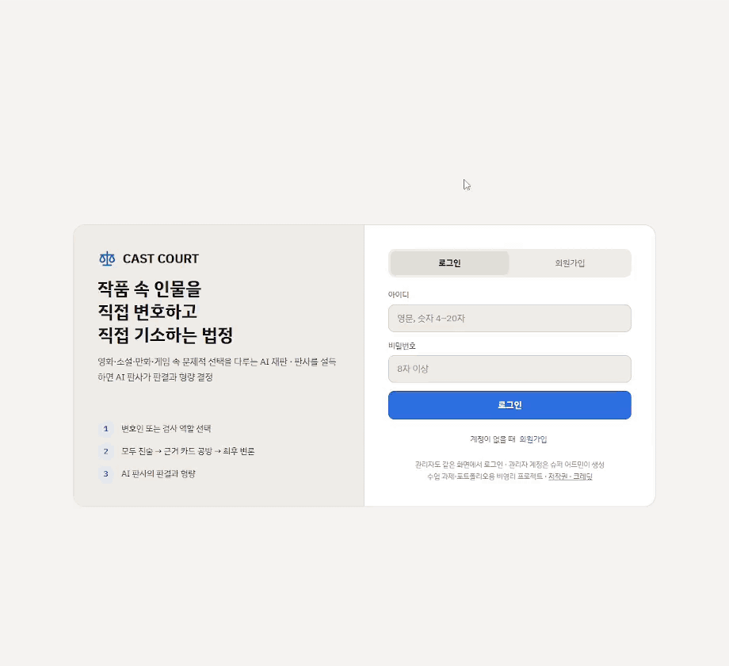
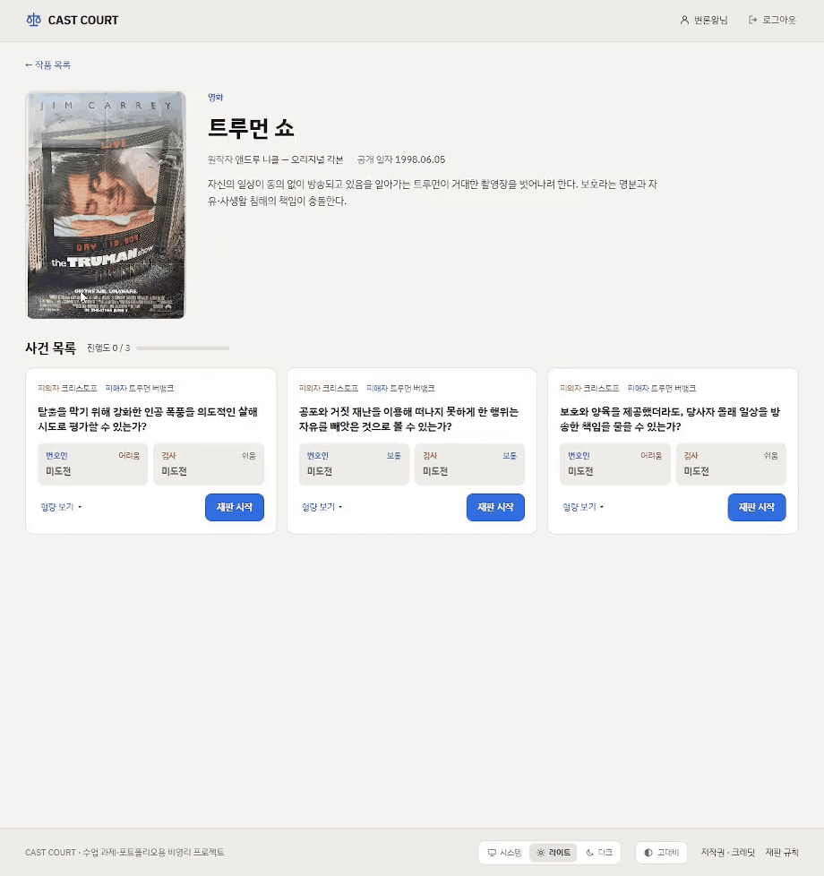
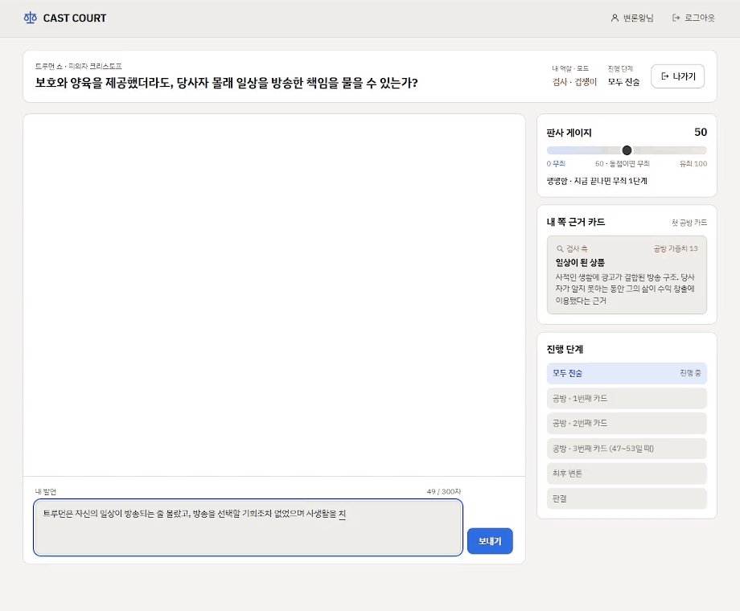
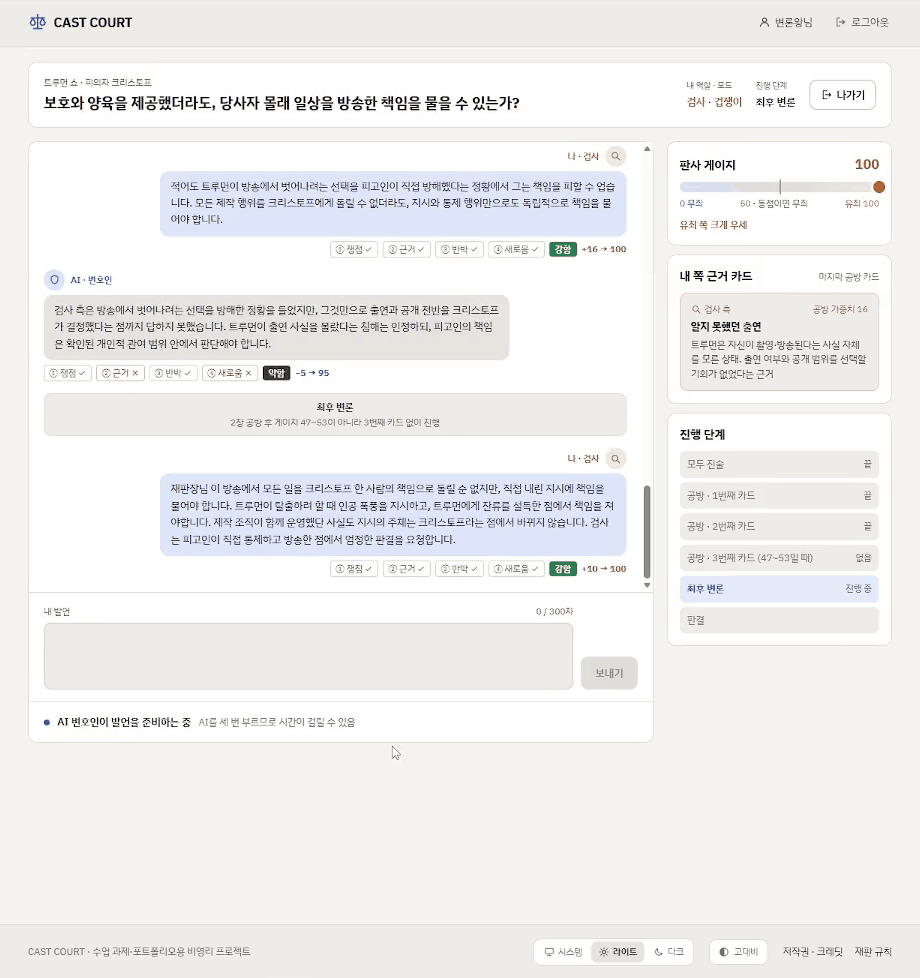
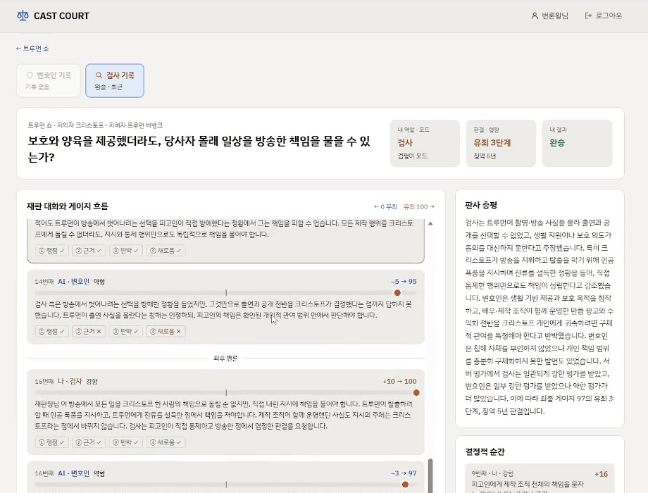
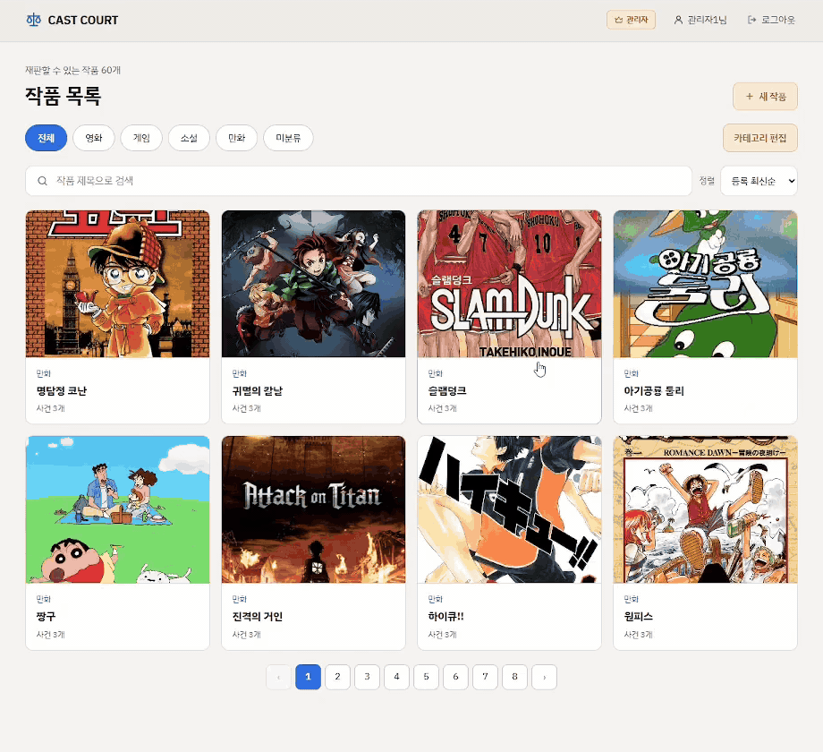
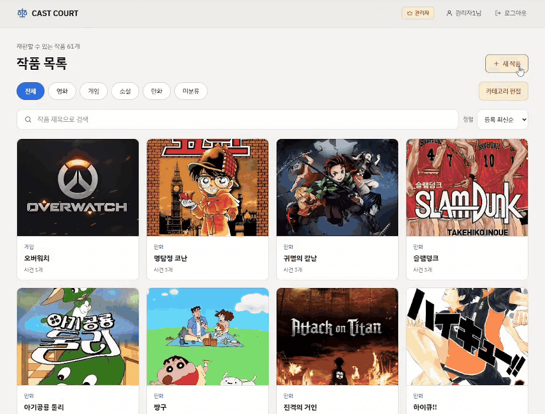
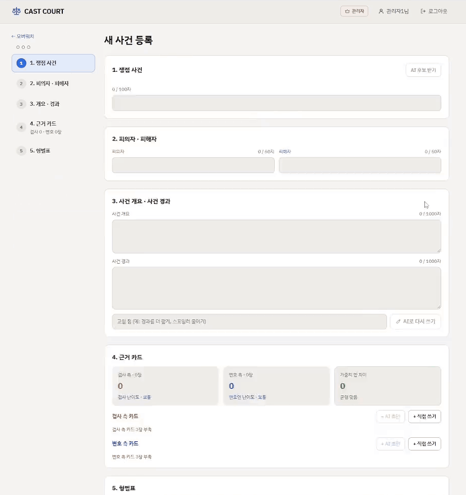
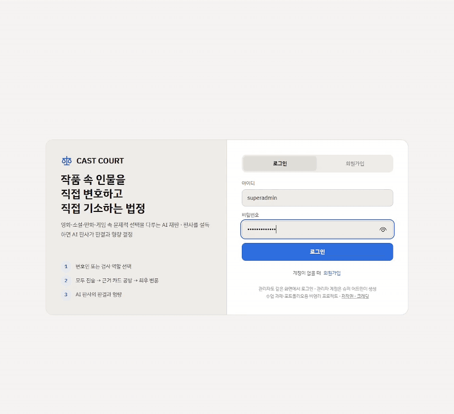

# CAST COURT — Backend

작품 속 인물의 선택을 재판하는 AI 법정 게임의 API 서버.
사용자는 검사나 변호인이 되어 AI 상대와 공방을 벌이고, AI 판사는 발언마다 판정한 뒤 최종 판결과 형량을 정한다.

## 시연

### 사용자

<details>
<summary><b>로그인 · 작품 탐색</b> — 카테고리 · 정렬 · 검색으로 작품을 찾고, 작품 상세에서 사건을 고른다.</summary>



</details>

<details>
<summary><b>재판 준비</b> — 역할(검사 / 변호인)과 모드를 고른 뒤 재판을 시작한다.</summary>



</details>

<details>
<summary><b>재판 진행</b> — 내 발언을 판사 AI가 판정하고, 상대 AI가 실시간(SSE)으로 반론한다. 판정 등급에 따라 판사 게이지가 움직인다.</summary>



</details>

<details>
<summary><b>판결 · 재판 기록</b> — 최후 변론이 끝나면 최종 게이지로 형벌 단계가 정해지고, 발언별 판정 기록을 다시 볼 수 있다.</summary>



</details>

<details>
<summary><b>내 재판 기록</b> — 지금까지의 재판 수 · 결과 통계 · 재판 목록.</summary>



</details>

### 관리자

<details>
<summary><b>카테고리 관리</b> — 작품 카테고리를 추가하고 편집한다.</summary>



</details>

<details>
<summary><b>작품 등록</b> — 포스터를 업로드하고, AI 작품 소개 초안을 받아 등록한다.</summary>



</details>

<details>
<summary><b>사건 등록 · AI 초안</b> — WebSocket으로 쟁점 후보, 사건 개요 · 경과 다시 쓰기, 근거 카드 · 형벌표 초안을 받아 사건을 만든다.</summary>



</details>

<details>
<summary><b>관리자 계정 관리</b> (<code>SUPER_ADMIN</code>) — 관리자 계정을 만들고 비활성화한다. 비활성화된 계정은 로그인할 수 없다.</summary>



</details>

## 기술 스택

| 구분 | 사용 |
|---|---|
| 언어 · 런타임 | Java 21 |
| 프레임워크 | Spring Boot 4.1.1 (Web MVC, Data JPA, Security, WebSocket, AOP, Actuator) |
| DB | MySQL (`mysql-connector-j`) |
| 인증 | JWT (`jjwt` 0.13.0), BCrypt |
| AI | OpenAI Responses API (`global/ai/OpenAiClient`) |
| 문서 | springdoc-openapi 3.1.0 (Swagger UI) |
| 모니터링 | Micrometer + Prometheus, Grafana 대시보드 |
| 빌드 · 테스트 | Gradle, JUnit 5, Mockito, Lombok |

## 실행 방법

### 1. DB 준비

`sql/` 폴더의 스크립트를 순서대로 실행한다. (`sql/` 은 `.gitignore` 대상이라 로컬에서만 관리된다.)

1. `CREATE_USER_DATABASE.sql` — root 계정으로 `castcourt` 계정과 `courtdb` 데이터베이스 생성
2. `CREATE_TABLE_SCRIPT.sql` — 테이블 생성 (기존 테이블을 DROP 후 다시 만든다)
3. `INSERT_DATA.sql` — 초기 데이터

JPA `generate-ddl` 은 꺼져 있으므로 스키마는 반드시 스크립트로 만든다.

### 2. 환경 변수

`application.yaml` 은 아래 값을 환경 변수에서 읽는다. IntelliJ 실행 구성이나 셸에 설정한다.

| 변수 | 필수 | 설명 |
|---|---|---|
| `DB_URL` | O | 예: `jdbc:mysql://localhost:3306/courtdb` |
| `DB_DRIVER` | O | `com.mysql.cj.jdbc.Driver` |
| `DB_USERNAME` | O | DB 계정 |
| `DB_PASSWORD` | O | DB 비밀번호 |
| `JWT_SECRET` | O | JWT 서명 키 |
| `OPENAI_API_KEY` | - | 없으면 서버는 뜨지만 AI 기능(발언 판정 · AI 초안)이 동작하지 않는다 |

### 3. 서버 실행

```bash
./gradlew bootRun        # Windows: gradlew.bat bootRun
```

- 포트: `8080`
- Swagger UI: http://localhost:8080/swagger-ui.html
- CORS · WebSocket 허용 출처: `http://localhost:5173`, `http://192.168.*:5173` (FE 개발 서버)

### 4. 테스트

```bash
./gradlew test
```

- `OpenAiCaseDraftLiveTest` 는 `OPENAI_API_KEY` 가 있을 때만 실제 API를 호출한다.
- `AiModelBenchmarkTest` (`@Tag("ai-benchmark")`) 는 `OPENAI_API_KEY` 와 `AI_BENCHMARK=true` 가 모두 있을 때만 실행된다.

## 프로젝트 구조

```
src/main/java/com/verdict/castcourt
├── domain
│   ├── account        계정 · 로그인 · 관리자 관리
│   ├── category       작품 카테고리
│   ├── work           작품 (포스터 업로드, AI 작품 소개 초안)
│   ├── workcase       사건 (등록 · 수정 · 재판 준비, AI 사건 초안 WebSocket)
│   ├── evidencecard   근거 카드 (AI 카드 초안 WebSocket)
│   ├── penaltytier    형벌 단계 (AI 형량 초안 WebSocket)
│   ├── trial          재판 (시작 · 상태 · 판결 · 기록 · 통계, 게이지/난이도/공개 규칙)
│   └── speaking       발언 제출(SSE), 상대 AI · 판사 AI · 판결 AI
└── global
    ├── ai             OpenAI 클라이언트, 토큰 사용량
    ├── config         CORS, OpenAPI
    ├── exception      BusinessException, ErrorCode, 전역 예외 처리
    ├── infra/log      API 접근 로그 필터, AI 사용량 로그(AOP)
    ├── metrics        커스텀 Prometheus 지표
    ├── response       Single / List / Page / Error 응답 형식
    ├── security       JWT 필터 · 토큰 발급 · SecurityConfig
    └── websocket      BaseWebSocketHandler, 핸들러 자동 등록
```

기타 폴더

| 폴더 | 내용 |
|---|---|
| `http/` | IntelliJ HTTP Client 로 AI 초안 WebSocket을 시험하는 요청 파일 |
| `monitoring/` | `prometheus.yml`, `alert-rules.yml`, `grafana-dashboard.json` |
| `uploads/posters/` | 업로드된 작품 포스터 (`GET /uploads/**` 로 공개, git 제외) |
| `logs/` | 실행 로그 (git 제외) |

## 권한

| 권한 | 설명 |
|---|---|
| `USER` | 일반 사용자. `/signup/user` 로 가입 |
| `ADMIN` | 작품 · 사건 · 카테고리 관리, AI 초안 사용 |
| `SUPER_ADMIN` | ADMIN 권한 + 관리자 계정 생성 · 조회 · 비활성화 |

인증은 `Authorization: Bearer <token>` 헤더로 한다. 토큰 갱신 API는 없으며 만료되면 다시 로그인한다.

## API 요약

정확한 요청 · 응답 형식은 Swagger UI를 기준으로 한다.

### 계정

| Method | Path | 권한 | 설명 |
|---|---|---|---|
| POST | `/login` | 공개 | 로그인 (JWT 발급) |
| POST | `/signup/user` | 공개 | 유저 회원가입 |
| POST | `/signup/admin` | SUPER_ADMIN | 관리자 계정 생성 |
| GET | `/account/admin` | SUPER_ADMIN | 관리자 목록 |
| DELETE | `/admin/{id}` | SUPER_ADMIN | 관리자 비활성화 |

### 카테고리 · 작품

| Method | Path | 권한 | 설명 |
|---|---|---|---|
| GET | `/api/categories` | 공개 | 카테고리 목록 |
| POST | `/api/admin/categories` | ADMIN | 카테고리 생성 |
| PATCH | `/api/admin/categories/{categoryId}` | ADMIN | 이름 변경 |
| PUT | `/api/admin/categories/order` | ADMIN | 순서 변경 |
| DELETE | `/api/admin/categories/{categoryId}` | ADMIN | 삭제 |
| GET | `/api/works` | 로그인 | 작품 목록 (페이지는 1부터) |
| GET | `/api/works/{workId}` | 로그인 | 작품 상세 |
| POST | `/api/admin/works` | ADMIN | 작품 등록 (multipart, 포스터 포함) |
| PUT | `/api/admin/works/{workId}` | ADMIN | 작품 수정 (multipart) |
| DELETE | `/api/admin/works/{workId}` | ADMIN | 작품 삭제 |
| POST | `/api/admin/works/summary-draft` | ADMIN | AI 작품 소개 초안 |

### 사건

| Method | Path | 권한 | 설명 |
|---|---|---|---|
| GET | `/api/works/{workId}/cases` | 로그인 | 사건 목록 |
| GET | `/api/cases/{caseId}/setup` | 로그인 | 재판 준비 정보 |
| GET | `/api/admin/cases/{caseId}` | ADMIN | 사건 불러오기 (수정용) |
| POST | `/api/admin/cases` | ADMIN | 사건 등록 (근거 카드 · 형벌 단계 포함) |
| PUT | `/api/admin/cases/{caseId}` | ADMIN | 사건 수정 |
| DELETE | `/api/admin/cases/{caseId}` | ADMIN | 사건 삭제 |

### 재판 · 발언

| Method | Path | 설명 |
|---|---|---|
| POST | `/api/trials` | 재판 시작 |
| GET | `/api/trials/{trialId}` | 재판 상태 |
| POST | `/api/trials/{trialId}/speakings` | 발언 제출 — **SSE** 응답 |
| POST | `/api/trials/{trialId}/verdict` | 판결 받기 |
| DELETE | `/api/trials/{trialId}` | 재판 나가기 |
| GET | `/api/trials/{trialId}/record` | 재판 기록 |
| GET | `/api/cases/{caseId}/records` | 사건 기록 요약 |
| GET | `/api/users/me/trials` | 내 재판 목록 |
| GET | `/api/users/me/stats` | 내 통계 |

모두 로그인이 필요하다.

### 발언 SSE 이벤트

`POST /api/trials/{trialId}/speakings` 는 `text/event-stream` 으로 한 턴의 진행을 보낸다. (타임아웃 180초)

| event | 내용 |
|---|---|
| `judge` | 내 발언에 대한 판사 판정 |
| `opponent_delta` | 상대 AI 발언 스트리밍 조각 |
| `opponent_judge` | 상대 발언에 대한 판사 판정 |
| `stage` | 재판 단계 전환 |
| `turn_done` | 턴 종료 |
| `error` | 오류 |

### 관리자 AI 초안 WebSocket

| Path | 용도 |
|---|---|
| `/ws/admin/case-draft` | 사건 초안 (`CANDIDATES`, `REWRITE`) |
| `/ws/admin/evidence-card-draft` | 근거 카드 초안 (`CARDS`, `CARD_SUGGEST`) |
| `/ws/admin/penalty-draft` | 형벌 단계 초안 (`PENALTY`) |

- 핸드셰이크에는 토큰을 붙일 수 없으므로 연결 후 첫 메시지로 `{ "type": "auth", "token": "<JWT>" }` 를 보낸다. 인증 성공 응답은 따로 없다.
- 서버 메시지: `delta { text }` · `done { json }` · `error { status, code, message }`
- 인증 · 권한 실패 시 `1008` 로 닫힌다.
- 새 핸들러는 `BaseWebSocketHandler` 를 상속하고 `path()` 만 구현하면 `WebSocketConfig` 가 자동 등록한다.

## 게임 규칙 (코드 기준)

- **역할**: `PROSECUTION`(검사, 게이지를 100 쪽으로) / `DEFENSE`(변호인, 0 쪽으로). AI는 반대편을 맡는다.
- **단계**: `OPENING`(모두 진술) → `CARD`(공방 카드마다 공격 · 반론 3번씩) → `CLOSING`(최후 변론)
- **판정 등급**: 판사 AI가 쟁점 · 근거 · 반박 · 새로움 4항목을 판단해 `STRONG`(100%) / `OK`(60%) / `WEAK`(30%) / `OFF`(0%) 를 매긴다.
- **게이지**: 50에서 시작, 변화량 = 카드 가중치 × 등급 배율. 0~100 범위로 자르고 최종 값으로 형벌 단계(1~6)를 정한다.
- **모드**: `CHICKEN`(게이지 · 판정 · 내 쪽 카드 공개) / `CHALLENGER`(게이지 · 변화량 · 사건 경과 공개) / `IRON`(판결 전까지 비공개)

관련 코드: `domain/trial/rule/` (`ScoreRule`, `JudgeRule`, `DifficultyRule`, `VisibilityRule`), `domain/speaking/entity/Grade`

## 응답 형식

- 성공: `SingleResponse` / `ListResponse` / `PageResponse` (`global/response`)
- 실패: `{ statusCode, businessCode, message }` — 코드 목록은 `global/exception/ErrorCode`

## 로그 · 모니터링

로그 파일은 `logs/` 에 날짜별로 쌓인다 (`logback-spring.xml`).

| 파일 | 내용 |
|---|---|
| `cast-court.log` | 전체 로그 |
| `cast-court-error.log` | 에러 로그 |
| `api-access.log` | API 접근 로그 (`ApiAccessLogFilter`) |
| `ai-usage.log` | AI 기능별 토큰 사용량 (`AiUsageAspect`) |

Actuator

- 공개: `/actuator/health`, `/actuator/info`, `/actuator/prometheus`
- 그 외 Actuator 엔드포인트는 `ADMIN` · `SUPER_ADMIN` 만 접근 가능
- 헬스 그룹: `/actuator/health/liveness`, `/actuator/health/readiness`

Prometheus 는 `monitoring/` 에서 실행한다.

```bash
cd monitoring
prometheus --config.file=prometheus.yml --storage.tsdb.path=data
```

Grafana 에는 `monitoring/grafana-dashboard.json` 을 가져와 쓴다.

## 협업

PR 은 `.github/pull_request_template.md` 양식을 따른다. (테스트 코드, Swagger 반영, 로컬 빌드 · 실행 확인, 관련 문서 갱신)
